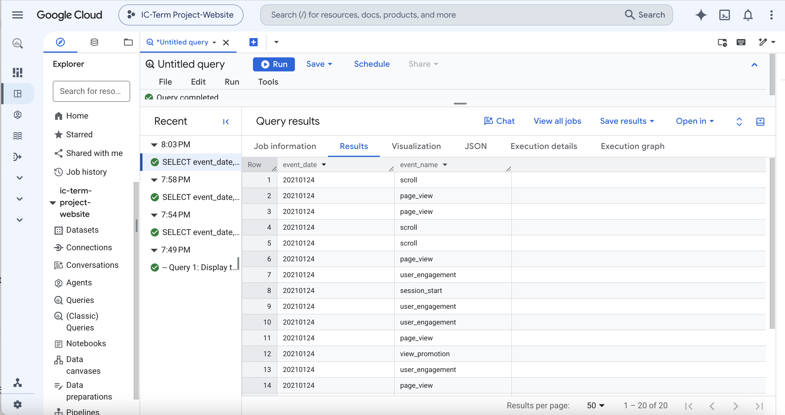
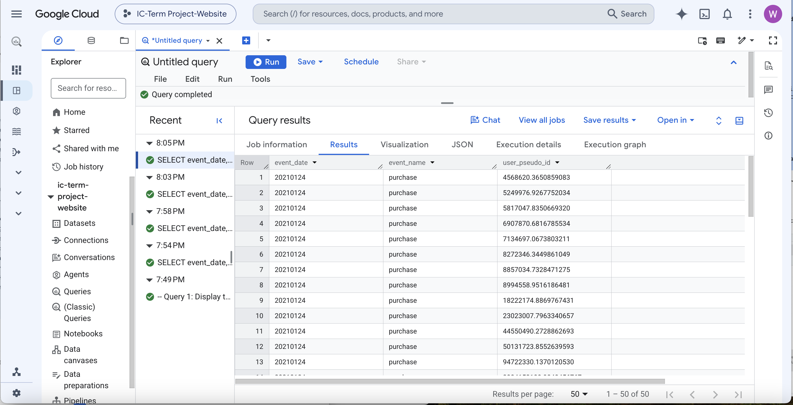
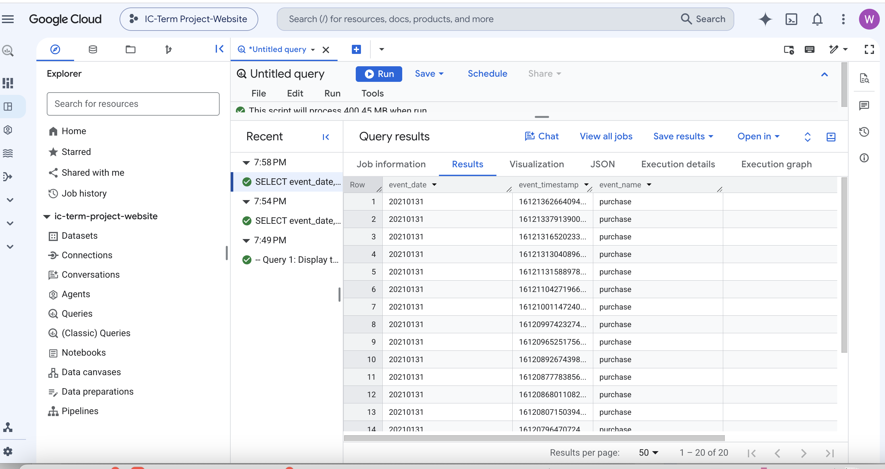
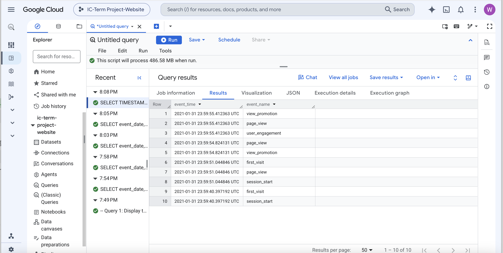
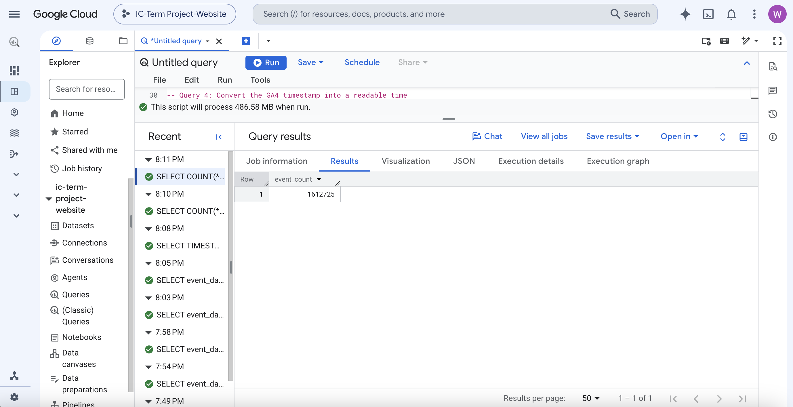
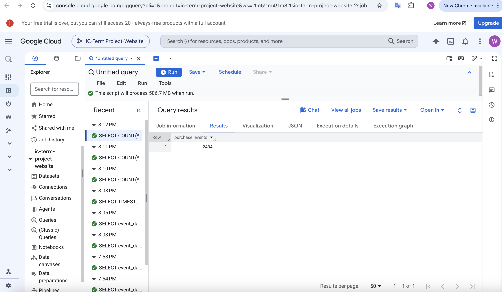
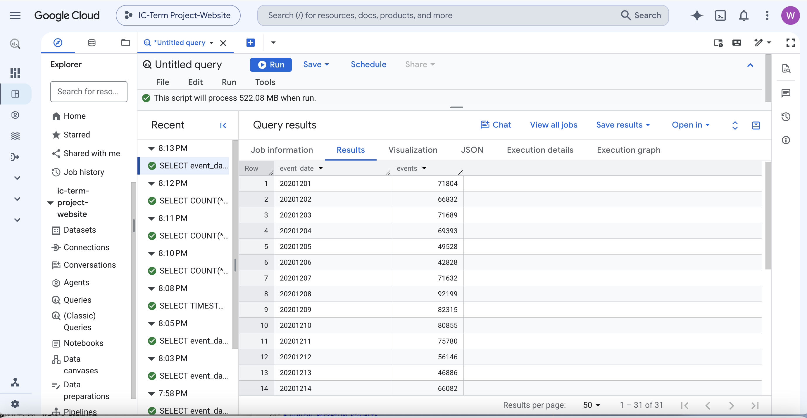
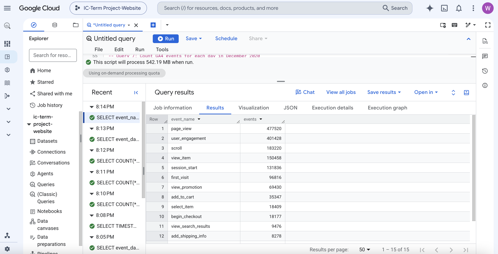
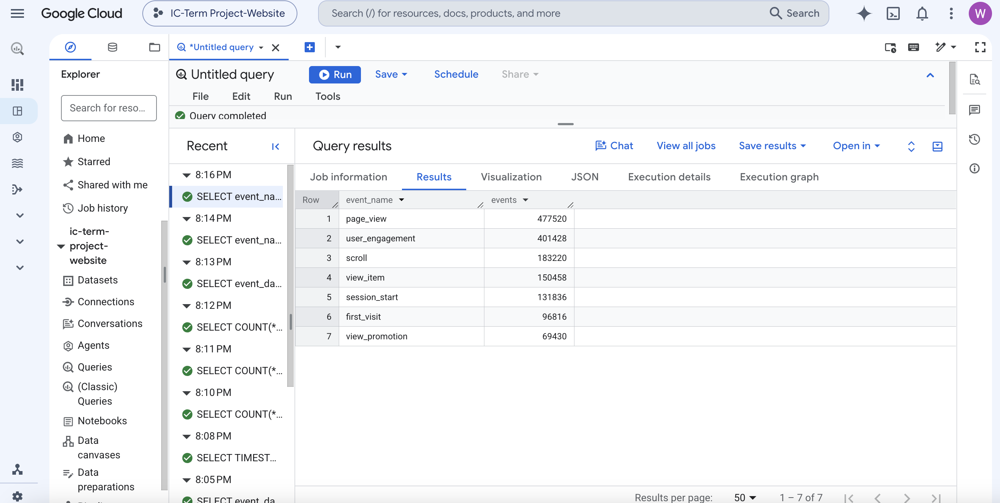
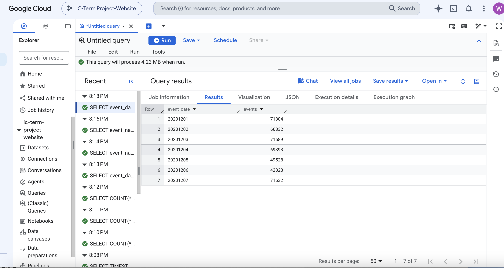

# Introduction

This notebook documents ten introductory SQL queries completed in Google BigQuery. The queries use the public `ga4_obfuscated_sample_ecommerce` dataset. They demonstrate how to select and filter rows, sort results, convert timestamps, calculate totals, group records, filter aggregated results, and limit wildcard tables to selected dates.

The SQL blocks below are included for documentation and are not executed inside Quarto. Each query was run in BigQuery, and its output is shown in a screenshot.

# Selecting and Filtering Rows

## Query 1: `SELECT`, `FROM`, and `LIMIT`

``` sql
SELECT
  event_date,
  event_name
FROM `bigquery-public-data.ga4_obfuscated_sample_ecommerce.events_*`
LIMIT 20;
```

This query selects the event date and event name from the public GA4 e-commerce dataset. The `LIMIT` clause restricts the output to 20 rows, making the results easier to review.

{fig-alt="BigQuery output showing the first 20 GA4 event dates and event names"}

The output contains 20 GA4 event records. The visible results include events such as `page_view`, `scroll`, `user_engagement`, and `session_start`.

## Query 2: Filtering Purchase Events with `WHERE`

``` sql
SELECT
  event_date,
  event_name,
  user_pseudo_id
FROM `bigquery-public-data.ga4_obfuscated_sample_ecommerce.events_*`
WHERE event_name = 'purchase'
LIMIT 50;
```

This query uses a `WHERE` condition to keep only purchase events. It returns the event date, event name, and anonymous user ID for the first 50 matching records.

{fig-alt="BigQuery output showing purchase event dates, event names, and anonymous user IDs"}

The output contains 50 rows, and every visible value in the `event_name` column is `purchase`. The `user_pseudo_id` column distinguishes anonymous users associated with the events.

## Query 3: Sorting Purchases with `ORDER BY`

``` sql
SELECT
  event_date,
  event_timestamp,
  event_name
FROM `bigquery-public-data.ga4_obfuscated_sample_ecommerce.events_*`
WHERE event_name = 'purchase'
ORDER BY event_timestamp DESC
LIMIT 20;
```

This query filters the data to purchase events and sorts them by event timestamp in descending order. The most recent purchase events therefore appear first, and `LIMIT` restricts the output to 20 rows.

{fig-alt="BigQuery output showing purchase events sorted from newest to oldest"}

The visible records are dated January 31, 2021. The numeric timestamps decrease down the table, confirming that the rows are sorted from newest to oldest.

## Query 4: Converting a GA4 Timestamp

``` sql
SELECT
  TIMESTAMP_MICROS(event_timestamp) AS event_time,
  event_name
FROM `bigquery-public-data.ga4_obfuscated_sample_ecommerce.events_*`
ORDER BY event_timestamp DESC
LIMIT 10;
```

GA4 stores `event_timestamp` in microseconds. This query uses `TIMESTAMP_MICROS()` to convert that number into a readable timestamp, sorts the events from newest to oldest, and returns ten records.

{fig-alt="BigQuery output showing readable UTC event times and event names"}

The output displays readable UTC dates and times instead of long integers. The latest visible events occurred near 11:59:55 PM UTC on January 31, 2021.

# Aggregating Events

## Query 5: Counting All Events

``` sql
SELECT
  COUNT(*) AS event_count
FROM `bigquery-public-data.ga4_obfuscated_sample_ecommerce.events_*`
WHERE _TABLE_SUFFIX BETWEEN '20201201' AND '20201231';
```

This query counts all GA4 events recorded during December 2020. The `_TABLE_SUFFIX` condition limits the scan to daily event tables from December 1 through December 31.

{fig-alt="BigQuery output showing a total December event count of 1612725"}

The result shows **1,612,725 total events** during December 2020.

## Query 6: Counting Purchase Events

``` sql
SELECT
  COUNT(*) AS purchase_events
FROM `bigquery-public-data.ga4_obfuscated_sample_ecommerce.events_*`
WHERE event_name = 'purchase'
  AND _TABLE_SUFFIX BETWEEN '20201201' AND '20201231';
```

This query also examines December 2020, but it adds an `event_name = 'purchase'` condition. It therefore counts only purchase events rather than all recorded activities.

{fig-alt="BigQuery output showing 2434 purchase events in December 2020"}

The result shows **2,434 purchase events** during the month. This is a small subset of the 1,612,725 total events counted in Query 5.

## Query 7: Daily Event Counts with `GROUP BY`

``` sql
SELECT
  event_date,
  COUNT(*) AS events
FROM `bigquery-public-data.ga4_obfuscated_sample_ecommerce.events_*`
WHERE _TABLE_SUFFIX BETWEEN '20201201' AND '20201231'
GROUP BY event_date
ORDER BY event_date;
```

This query groups December records by `event_date` and counts the number of events in each group. `ORDER BY` arranges the 31 dates from earliest to latest.

{fig-alt="BigQuery output showing 31 daily event totals for December 2020"}

The output contains one row for each day of December. Among the visible rows, December 8 has 92,199 events, while December 6 has 42,828 events, showing that activity varies by day.

## Query 8: Most Common Event Types

``` sql
SELECT
  event_name,
  COUNT(*) AS events
FROM `bigquery-public-data.ga4_obfuscated_sample_ecommerce.events_*`
WHERE _TABLE_SUFFIX BETWEEN '20201201' AND '20201231'
GROUP BY event_name
ORDER BY events DESC
LIMIT 15;
```

This query groups records by event name, counts each group, sorts the counts from highest to lowest, and returns the 15 most common event types in December 2020.

{fig-alt="BigQuery output listing the 15 most common GA4 events in December 2020"}

`page_view` is the most common event with 477,520 records. It is followed by `user_engagement` with 401,428 records and `scroll` with 183,220 records.

## Query 9: Filtering Groups with `HAVING`

``` sql
SELECT
  event_name,
  COUNT(*) AS events
FROM `bigquery-public-data.ga4_obfuscated_sample_ecommerce.events_*`
WHERE _TABLE_SUFFIX BETWEEN '20201201' AND '20201231'
GROUP BY event_name
HAVING COUNT(*) >= 50000
ORDER BY events DESC;
```

This query groups and counts the December events, then uses `HAVING` to keep only event types with at least 50,000 records. Unlike `WHERE`, which filters rows before grouping, `HAVING` filters the aggregated groups.

{fig-alt="BigQuery output showing seven event types with counts of at least 50000"}

Seven event types meet the threshold: `page_view`, `user_engagement`, `scroll`, `view_item`, `session_start`, `first_visit`, and `view_promotion`.

# Wildcard Tables and Date Suffixes

## Query 10: Restricting Wildcard Tables with `_TABLE_SUFFIX`

``` sql
SELECT
  event_date,
  COUNT(*) AS events
FROM `bigquery-public-data.ga4_obfuscated_sample_ecommerce.events_*`
WHERE _TABLE_SUFFIX BETWEEN '20201201' AND '20201207'
GROUP BY event_date
ORDER BY event_date;
```

The wildcard in `events_*` allows BigQuery to access multiple daily tables. `_TABLE_SUFFIX` restricts the query to December 1 through December 7, which reduces the amount of data scanned.

{fig-alt="BigQuery output showing daily event totals from December 1 through December 7, 2020"}

The result contains seven rows, one for each day in the selected period. December 1 has 71,804 events, and December 6 has the lowest displayed count at 42,828 events.

# Summary

These queries demonstrate the basic order of SQL operations used in BigQuery. `WHERE` filters original rows, `GROUP BY` changes the level of the results, aggregate functions summarize records, `HAVING` filters grouped results, and `ORDER BY` controls the final display order. The wildcard-table examples also show how `_TABLE_SUFFIX` can limit the dates scanned in a GA4 export.
